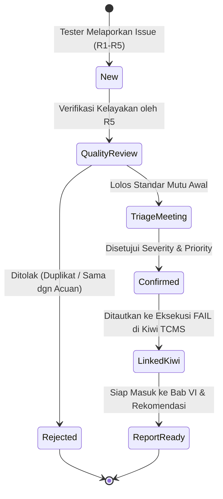

# 🔄 Panduan Alur Kerja Manajemen Cacat (Defect Management Workflow)
**Kelompok 3 - Praktikum Pengujian Perangkat Lunak**  
**Role Pengelola**: R5 (Defect Management Engineer)

---

## 1. Siklus Hidup Cacat (Defect Lifecycle)

Setiap cacat yang ditemukan oleh anggota tim mengikuti alur hidup terstruktur berikut:

1. **New (Baru)**: Anggota tim (R1–R5) membuat Issue baru di GitHub menggunakan template yang disediakan.
2. **Quality Review (Pemeriksaan Kualitas oleh R5)**: R5 memeriksa apakah:
   - Langkah reproduksi jelas dan lengkap.
   - Hasil di versi acuan (`practicesoftwaretesting.com`) sudah dicantumkan di Expected Result.
   - Judul dan isi memiliki versi Bahasa Inggris yang memadai.
   - Evidence lengkap (screenshot layar penuh, recording, atau console log).
3. **Triage Meeting**: Pertemuan rutin yang dipimpin R1 bersama R5 untuk menyepakati Severity dan Priority serta mencatat notulen triage (2-3 kalimat).
4. **Linked to Kiwi TCMS**: URL issue GitHub dicatat pada kolom komentar eksekusi FAIL di Kiwi TCMS, dan ID eksekusi dicatat pada issue GitHub.

---

## 2. Syarat Validitas Bug (Wajib Dipenuhi)

Sesuai instruksi resmi soal ujian, sebuah temuan **hanya sah** sebagai bug jika memenuhi kriteria:
1. **Dapat Direproduksi**: Anggota tim lain dapat memunculkan bug yang sama hanya dengan membaca dan mengikuti langkah-langkah yang tertulis.
2. **Memiliki Acuan Perilaku Benar (Test Oracle)**: Expected result wajib mencantumkan hasil dari situs acuan tanpa bug: [`https://practicesoftwaretesting.com`](https://practicesoftwaretesting.com) atau aturan UI yang terlihat (placeholder/pesan validasi).
3. **Tidak Duplikat**: Jika terdapat beberapa gejala dengan satu akar masalah yang sama (misal error API yang berdampak ke 3 halaman), laporkan dalam **satu issue**, lalu sebutkan daftar halaman yang terdampak.
4. **Memiliki Evidence**: Disertai tangkapan layar penuh (*full screen screenshot*), rekaman layar (*screen recording* untuk alur/intermiten), atau *console log* (untuk error JavaScript).
5. **Bukan Perilaku Standar**: Jika perilakunya sama persis dengan versi tanpa cacat, maka **BUKAN BUG**. Catat sebagai observasi atau pertanyaan pada *Session Notes* (R3).

---

## 3. Standar Penamaan Evidence & Struktur Berkas

Semua evidence wajib disimpan secara teratur di folder `evidence-uts/` dengan format penamaan standar:

* **Screenshot Layar Penuh**:  
  `evidence-uts/screenshots/BUG-XXX_judul-singkat.png`  
  *Contoh*: `BUG-001_kalkulasi-total-nan.png`, `BUG-002_tombol-checkout-unresponsive.png`
* **Screen Recording (Video)**:  
  `evidence-uts/recordings/BUG-XXX_judul-singkat.mp4`  
  *Contoh*: `BUG-003_alur-pembayaran-blank.mp4`
* **Console / Network Log**:  
  `evidence-uts/logs/BUG-XXX_judul-singkat.log`  
  *Contoh*: `BUG-001_error-console.log`

---

## 4. Cara Menautkan GitHub Issue dengan Kiwi TCMS (Tugas T8)

Agar *traceability* pengujian sempurna:
1. **Di GitHub Issue**:
   - Cantumkan ID Test Case Kiwi (misal: `TC-014`) dan link URL eksekusi Kiwi:
     `https://reg-beings-nurse-month.trycloudflare.com/runs/XX/executions/YY/`
2. **Di Kiwi TCMS**:
   - Buka Test Run yang sedang berjalan.
   - Pada Test Case yang gagal, pilih status **FAIL**.
   - Pada kotak **Comment**, tempelkan URL lengkap GitHub Issue:
     `GitHub Issue: https://github.com/[owner]/[repo]/issues/1`
   - Beri label di GitHub: `status: verified-in-kiwi`.

---

## 5. Target Kontribusi Minimum Tim
* Setiap anggota (**R1, R2, R3, R4, R5**) wajib menulis minimal **2 issue bug valid** atas akun GitHub masing-masing.
* Total bug report valid di repositori minimal **10 bug report**.
* Setiap anggota wajib mengeksekusi minimal **4 test case di Kiwi TCMS** dengan akunnya sendiri.
